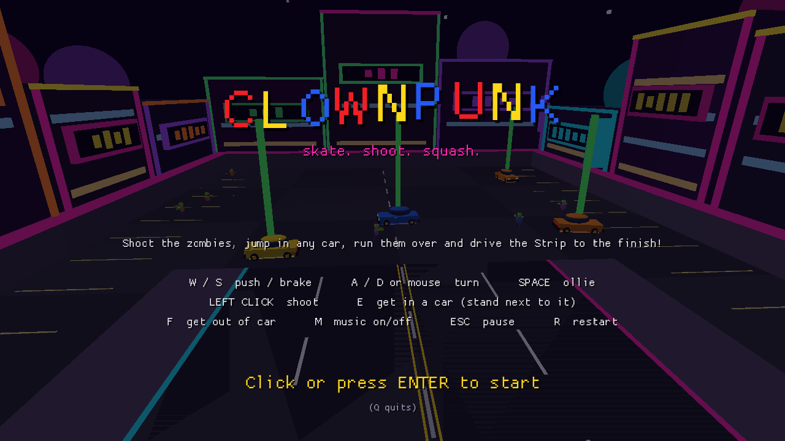
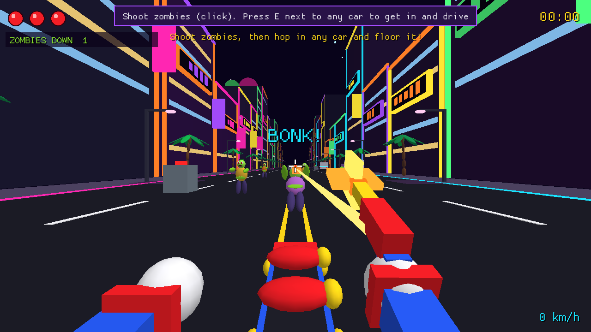
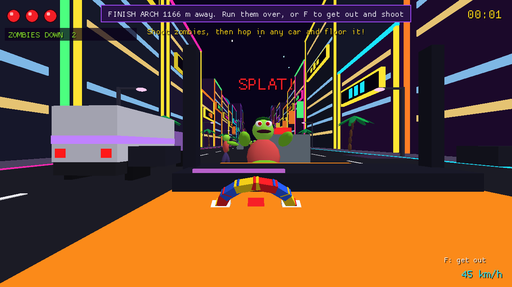
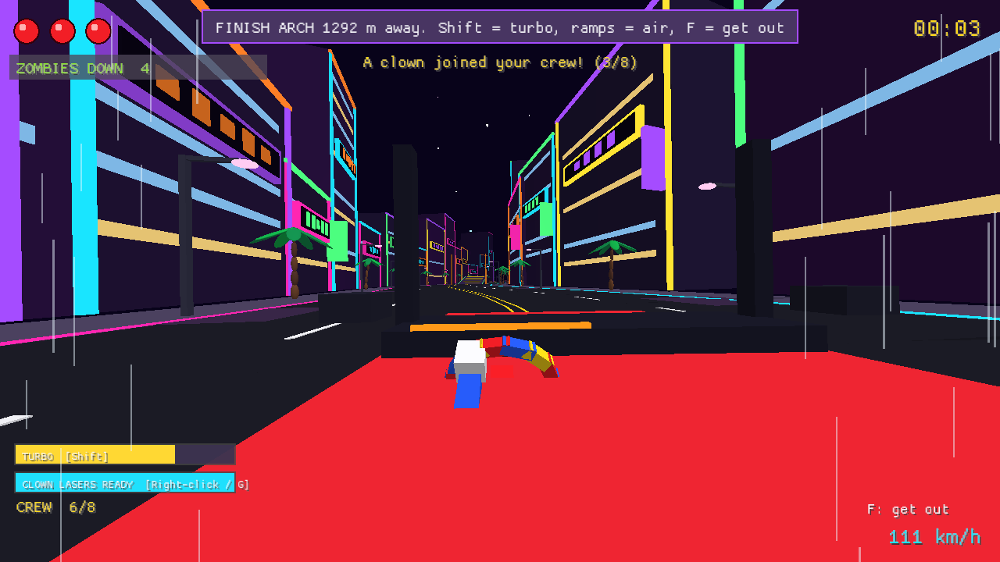
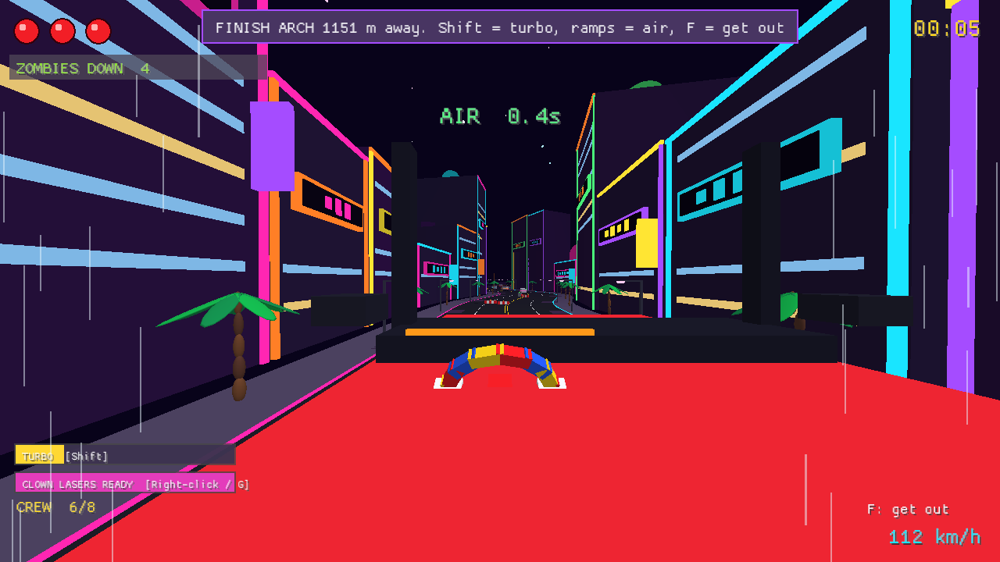
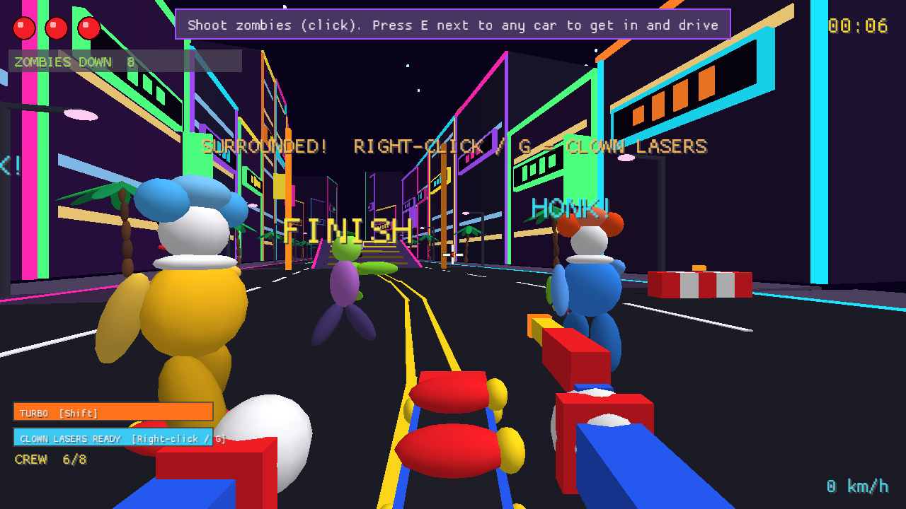

<p align="center">
  
</p>

<h1 align="center">ClownPunk</h1>

**ClownPunk** is a small offline first-person 3D game written in Rust, with a punk
soundtrack. You are a clown on a skateboard. Green zombies shamble after you through a parking lot. Shoot them
with a wobbly toy pistol (or run them over), jump in any car, then drive the neon
Las-Vegas-style Strip to the finish arch. The road winds left and right, jump
ramps launch your car into the air (with a guaranteed clear landing), Shift
gives you turbo, a crew of clown friends fights alongside you, and when the
zombies close in you can unleash your clown-laser super power. A run takes
about 5 minutes.

Everything is drawn with coloured boxes and rounded blobs, and the music is
synthesised at startup: no asset files, no textures, no samples. The only
dependency is [macroquad](https://crates.io/crates/macroquad) (window, input,
GL drawing, audio, random numbers).

## Screenshots

<p align="center">
  <br>
  <sub>The title screen, over the parking lot.</sub>
</p>
<p align="center">
  <br>
  <sub>Skating the neon Strip, shooting zombies with the wobbly pistol.</sub>
</p>
<p align="center">
  <br>
  <sub>Or jump in a car and run them over.</sub>
</p>

<p align="center">
  <br>
  <sub>The Strip winds left and right. Hold Shift for turbo.</sub>
</p>
<p align="center">
  <br>
  <sub>Hit a ramp at speed and fly. The landing zone ahead is always clear.</sub>
</p>
<p align="center">
  <br>
  <sub>Your clown crew follows you, rides on your car and shoots zombies.</sub>
</p>

## Download (no install, no Rust needed)

Pick your system, unpack, and run `clownpunk`:

| System | Download |
|--------|----------|
| Windows (64-bit) | [clownpunk-windows-x64.zip](https://github.com/noisyloop/ClownPunk/releases/latest/download/clownpunk-windows-x64.zip) |
| macOS (Apple Silicon) | [clownpunk-macos-arm64.zip](https://github.com/noisyloop/ClownPunk/releases/latest/download/clownpunk-macos-arm64.zip) |
| Linux (64-bit) | [clownpunk-linux-x64.zip](https://github.com/noisyloop/ClownPunk/releases/latest/download/clownpunk-linux-x64.zip) |

All releases: <https://github.com/noisyloop/ClownPunk/releases> (each release also lists SHA256 checksums in `SHA256SUMS.txt`).

Notes: the builds are unsigned. Windows SmartScreen may say "unknown publisher"
(More info > Run anyway). On macOS run
`xattr -d com.apple.quarantine clownpunk` once, then
`./clownpunk`. On Linux, `chmod +x` it if needed.

[](https://github.com/noisyloop/ClownPunk/actions/workflows/build.yml)

## Run it from source

```
cargo run --release
```

Linux needs the usual X11/OpenGL runtime libraries (`libx11`, `libxi`, `libgl`);
macOS and Windows work out of the box. Music needs ALSA: `libasound2` to run and
`libasound2-dev` to build (`sudo apt install libasound2-dev` on Debian/Ubuntu).
With no sound device the game simply runs silent. Set `CLOWNPUNK_NO_MUSIC=1` to
turn the music off.

## Controls

| Key / mouse            | On the skateboard                          | In the car              |
|------------------------|--------------------------------------------|-------------------------|
| **W** / **S**          | push (accelerate) / brake                  | gas / brake, then reverse |
| **A** / **D**          | carve left / right                         | steer                   |
| **Mouse**              | look (yaw + pitch); yaw also turns the board | look around the cabin |
| **Space**              | ollie (small hop)                          | -                       |
| **Left click**         | shoot the pistol                           | -                       |
| **Shift** (hold)       | turbo: a burst of speed (tank drains, then refills) | nitro: far past top speed, works in the air too |
| **Right click** / **G**| **clown lasers** (when the power bar is full) | same, from the car   |
| **E**                  | get into the nearest car (stand next to it) | -                      |
| **F**                  | -                                          | get out of the car      |
| **Esc**                | pause / resume                             | pause / resume          |
| **R**                  | restart (pause, Game Over and Win screens) | same                    |
| **M**                  | music on / off                             | same                    |
| **Q**                  | quit (title and pause screens)             | same                    |

## How to play

1. **Parking lot.** 6-8 zombies chase you. They are slower than your top speed
   but faster than you when you stand still, so keep moving. A zombie that
   touches you costs 1 of 3 hearts and knocks you back. 0 hearts = Game Over.
2. **Shoot** a zombie and it goes down for good. The HUD counts them.
3. Stand next to **any car** (they all have a green beacon) and press **E** to
   get in. No zombies needed.
4. **The Strip.** Groups of zombies are waiting all the way down the boulevard.
   Run them over: a moving car kills them and loses a little speed doing it.
   Barriers, vans and traffic cabinets are solid. Press **F** to get out (the
   car stops and waits) and shoot them from the board; **E** next to a car gets
   you back in.
5. **Curves.** The Strip swings left and right (S-bends and big swerves) between
   dead-straight stretches, so you steer instead of just holding W.
6. **Turbo.** Hold **Shift** to burn the turbo tank (about 3.5 s, refills in about
   6 s). In a car it takes you from 65 km/h to over 110 km/h; on the board it
   nearly doubles your speed.
7. **Ramps.** Five glowing orange-beaconed ramps sit on the straight stretches.
   Hit one at speed and the car flies (more speed = more distance). Past each
   ramp is a mint-green **landing zone**: no barriers, vans or zombies for 64 m,
   and a landing assist lines the car up with the road while you are in the air,
   so every jump ends on open road and you just keep driving. Big jumps charge
   your clown power.
8. **Your crew.** Two clowns start with you. More stand waving along the Strip
   (yellow beam, "JOIN US!"): skate or drive within about 9 m to recruit them,
   up to 8. On foot they hover around you; when you drive they climb onto the
   car (trunk, fenders, roof). Either way they shoot the nearest zombie.
9. **Clown lasers.** The power bar fills over time, with kills and with big
   jumps. When 3 or more zombies are around you, **SURROUNDED!** flashes: press
   **right click** (or **G**) and your eyes fire a ring of lasers that kills every
   zombie within 24 m, on foot or in a car.
10. Cross the glowing **finish arch** in a car to win.

## Code map (read in this order)

| File | What it does |
|------|--------------|
| `src/main.rs` | Entry point and the **fixed-timestep loop** (60 Hz ticks fed by an accumulator). |
| `src/state.rs` | The **game state machine** (`Mode`) and the per-tick simulation that connects everything: shooting, interactions, zombie contact, win/lose. Also holds the tests. |
| `src/player.rs` | **Skateboard movement**: heading vs velocity, grip and drift, ollie, mouse look, gun wobble. |
| `src/car.rs` | Arcade **car driving**, the **turbo** tank, and **ramp jumps** (height, gravity, landing assist). |
| `src/allies.rs` | Your **clown crew**: follow / ride / shoot. |
| `src/zombies.rs` | Zombie **AI states** (walking / dead) and bullet hit volumes. |
| `src/world.rs` | The static level: lot, the **winding Strip** (`road_z`), **ramps**, casinos, lamps, palms, obstacles. |
| `src/collision.rs` | **Collision and raycasting**: circle-vs-oriented-box push-out, ray-vs-box (slab), ray-vs-sphere. |
| `src/render.rs` | Draws the scene, first-person hands/board/dashboard, HUD and menus, using only `platform`. |
| `src/platform.rs` | **The only file that calls macroquad.** Window, input, camera, drawing, random. |
| `src/math.rs` | Tiny `Vec2` / `Vec3` / `Mat3` / `Color` so gameplay does not depend on any engine's types. |
| `src/music.rs` | The **punk soundtrack**, synthesised in code (distorted power chords, bass, drums) and played on a loop. |
| `src/icon.rs` | The clown **window / taskbar / .exe icon**, drawn in code. |
| `src/smoke.rs` | Optional headless screenshot test (only active with an env var). |

### Conventions

* +Y is up. Ground positions are `Vec2 { x: world X, y: world Z }`.
* A heading `yaw` points along `(cos yaw, sin yaw)`; "right" is `(-sin yaw, cos yaw)`.
  Increasing yaw turns right. Boxes use local axes x = forward, y = up, z = right.
* There is no physics library. Moving things are circles, static things are
  oriented boxes, and "physics" is: move, push out of overlaps, remove the
  velocity pointing into the surface.

### Swapping in your own engine (winit + wgpu)

Re-implement the public functions of `platform.rs` and nothing else changes:

* loop: `run`, `next_frame`, `frame_time`, `screen_size`
* input: `poll_input` (returns an `Input` of game actions, not raw keys),
  `set_mouse_captured`
* 3D: `begin_3d` (first-person camera), `begin_ui`, `world_to_screen`,
  `draw_box` (oriented box with fake face shading + distance fog, see `Mat`),
  `draw_aabb`, `draw_ball`
* 2D: `draw_rect`, `draw_circle`, `draw_ring`, `draw_text`, `text_width`
* misc: `seed_rng`, `rand_range`, `rand_chance`, `save_screenshot`, `env`

There is no lighting engine: `draw_box` bakes a fixed directional shade into
each face colour and fades colours toward the night colour with distance, which
is cheap to reproduce in a wgpu vertex shader.

### Tuning

Most feel parameters are plain constants at the top of `player.rs`, `car.rs`,
`zombies.rs` and `state.rs` (top speed, zombie speed, shot cooldown,
interaction range, ...), and `world.rs` (Strip length, obstacle density).

## Tests

```
cargo test --release
```

The tests run the real simulation without a window: shoot -> dead,
walls blocking bullets, get in any car / drive / finish,
damage and Game Over, skater top speed, roadkill, pause, and the collision maths,
plus the new features: the road's curves stay drivable, turbo speed and tank,
every ramp launches the car and lands it on the road inside the clear zone (slow,
fast and crooked approaches), an autopilot drives the whole winding Strip with
all five jumps, clown lasers (on foot and in a car), crew following / riding /
shooting, and recruiting.

Headless screenshot smoke test (Linux, needs `xvfb`):

```
CLOWN_AUTOSHOT=/tmp/shot xvfb-run -a ./target/release/clownpunk
```

## Known simplifications (it is a sketch)

* The renderer draws the latest simulation state without interpolating between
  fixed ticks, so on very high refresh rates motion can look slightly steppy.
* Zombie pathing is "walk at the target and slide along walls"; they can get
  stuck behind big obstacles.
* No sound, no save data, no gamepad.
